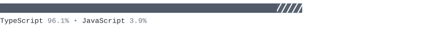

<!-- START:readme-typing -->
<picture>
  <source media="(prefers-color-scheme: dark)" srcset="https://readme-typing-svg.demolab.com/?lines=Make+it+happen.&amp;font=SF+Mono&amp;size=20&amp;width=260&amp;height=28&amp;duration=2500&amp;pause=1000&amp;repeat=true&amp;vCenter=true&amp;background=00000000&amp;color=E5E7EB" />
  
</picture>
<!-- END:readme-typing -->

   
     <picture>
       <source media="(prefers-color-scheme: dark)" srcset="https://api.iconify.design/mdi/web.svg?color=%23E5E7EB" />
       
     </picture>
     <a href="https://oryz.work/" aria-label="Personal website">me</a>
   
   ·
   
     <picture>
       <source media="(prefers-color-scheme: dark)" srcset="https://api.iconify.design/mdi/github.svg?color=%23E5E7EB" />
       
     </picture>
     <a href="https://github.com/Orchardxyz" aria-label="GitHub profile">orchardxyz</a>
   
   ·
   
     <picture>
       <source media="(prefers-color-scheme: dark)" srcset="https://api.iconify.design/mdi/email-outline.svg?color=%23E5E7EB" />
       
     </picture>
     <a href="mailto:orchardyz@outlook.com" aria-label="Email Orchardxyz">orchardyz@outlook.com</a>
   

▸ Frameworks

<!-- START:frameworks -->

  <picture><source media="(prefers-color-scheme: dark)" srcset="https://skillicons.dev/icons?i=astro&amp;theme=dark" /></picture>
  <picture><source media="(prefers-color-scheme: dark)" srcset="https://skillicons.dev/icons?i=react&amp;theme=dark" /></picture>
  <picture><source media="(prefers-color-scheme: dark)" srcset="https://skillicons.dev/icons?i=svelte&amp;theme=dark" /></picture>
  <picture><source media="(prefers-color-scheme: dark)" srcset="https://skillicons.dev/icons?i=vue&amp;theme=dark" /></picture>
  <picture><source media="(prefers-color-scheme: dark)" srcset="./assets/framework-hono-dark.svg" /></picture>
  <picture><source media="(prefers-color-scheme: dark)" srcset="https://skillicons.dev/icons?i=nextjs&amp;theme=dark" /></picture>

<!-- END:frameworks -->

▸ Recent languages

<!-- START:recent-languages -->
<picture>
  <source media="(prefers-color-scheme: dark)" srcset="./assets/recent-languages-dark.svg" />
  
</picture>
<!-- END:recent-languages -->
